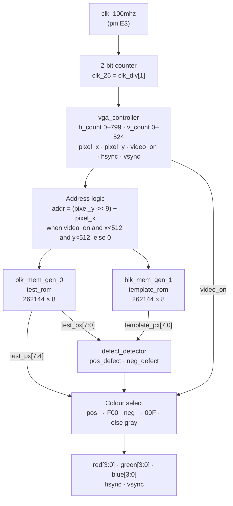

```mermaid
flowchart LR
    A["PCB images<br/>(template + test)"] --> B["Offline preprocessing<br/>grayscale · 512×512 · 8-bit"]
    B --> C["COE files<br/>(bram_inputs/)"]
    C --> D["Block Memory Generator IP<br/>(ROM initialisation)"]
    D --> E["FPGA BRAM<br/>template ROM + test ROM"]
    E --> F["defect_detector<br/>(combinational)"]
    F --> G["Colour select<br/>(top module)"]
    G --> H["VGA output<br/>640×480 @ 60 Hz"]
    style B stroke-dasharray: 5 5
    style C stroke-dasharray: 5 5
```

<div align="center">

# 🔍 PCB Error Detection Using Image Processing on FPGA

**Pixel-wise PCB defect highlighting in Verilog HDL, with images stored in BRAM and results shown live over VGA on the Nexys DDR4 board**


*Second-year academic project · Department of Electronics and Communication Engineering · NIT Warangal*

</div>

---

## 📑 Table of Contents

1. [Overview](#-overview)
2. [Motivation and Problem Statement](#-motivation-and-problem-statement)
3. [Objectives](#-objectives)
4. [Hardware and Software Requirements](#-hardware-and-software-requirements)
5. [System Architecture](#-system-architecture)
6. [Working Principle](#-working-principle)
7. [Image-Processing Methodology](#-image-processing-methodology)
8. [Defect Detection Algorithm](#-defect-detection-algorithm)
9. [Hardware Implementation Details](#-hardware-implementation-details)
10. [Memory and BRAM Initialization](#-memory-and-bram-initialization)
11. [VGA Display Implementation](#-vga-display-implementation)
12. [Results](#-results)
13. [Repository Structure](#-repository-structure)
14. [How to Open and Run in Vivado](#-how-to-open-and-run-in-vivado)
15. [Limitations and Future Improvements](#-limitations-and-future-improvements)
16. [Authors](#-authors)

---

## 📌 Overview

This project compares a **reference ("template") PCB image** with a **test PCB image** entirely in FPGA hardware. Both images are 512 × 512 pixels, 8-bit grayscale, and are stored in on-chip Block RAM (BRAM) initialised from Xilinx `.coe` files.

While a VGA monitor is being refreshed, the design reads the same address from both BRAMs on every pixel clock and compares the two pixel values in a small combinational module. The result is drawn directly on screen:

| Pixel condition | Colour on the VGA monitor |
|---|---|
| Test pixel **brighter** than the template by more than 10 grey levels | 🟥 **Red** |
| Test pixel **darker** than the template by more than 10 grey levels | 🟦 **Blue** |
| Difference within 10 grey levels | ⬜ Test image in grayscale (4-bit) |

The detection path (BRAM read → comparator → colour select → VGA pins) is implemented purely in hardware. There is no processor, soft core or external memory in the design.

---

## 🎯 Motivation and Problem Statement

PCB faults such as open circuits, short circuits, spurious copper and missing conductors appear as local differences in appearance between a good board and a faulty one. Manual inspection is subjective and tiring, and software-based comparison on a PC depends on the host machine.

This project implements a **template-comparison approach directly in FPGA logic** and presents the result to the operator as a colour-coded image on a standard VGA monitor.

---

## ✅ Objectives

- Store a reference PCB image and a test PCB image in on-chip BRAM.
- Compare corresponding pixels of the two images in hardware.
- Distinguish brighter-than-reference and darker-than-reference regions.
- Display the result over VGA at 640 × 480 @ 60 Hz.
- Implement and demonstrate the design on a Nexys DDR4 board using Verilog HDL and Vivado.

---

## 🧰 Hardware and Software Requirements

### Hardware

| Item | Details |
|---|---|
| FPGA board | Digilent **Nexys DDR4** with Artix-7 **XC7A100T-1CSG324** |
| Display | VGA monitor and cable (4 bits each for R, G, B) |
| Programming | USB cable (JTAG) |

### Software

| Item | Purpose |
|---|---|
| Xilinx Vivado | Synthesis, implementation, bitstream generation |
| Python | Conversion of the grayscale `.mem` file to `.coe` format (as described in the project report) |

---

## 🧱 Technologies Used

| Layer | Technology |
|---|---|
| Design entry | Verilog HDL |
| Memory | Vivado Block Memory Generator IP (Single-Port ROM) |
| Memory initialisation | Xilinx COE files |
| Display | Custom VGA timing generator, 640 × 480 @ 60 Hz |
| Constraints | Vivado XDC |
| Target | Artix-7 FPGA (Nexys DDR4) |

---

## 🏗 System Architecture

### End-to-end flow



*Dashed blocks are performed on a PC before programming the FPGA. The rest runs on the FPGA.*

### RTL architecture



### Module summary

| File | Module | Role |
|---|---|---|
| `pcb_inspection_top.v` | `pcb_inspection_top` | Top level. Divides the 100 MHz clock to 25 MHz, instantiates the VGA controller, both ROMs and the detector, forms the ROM address and selects the output colour. |
| `vga_controller.v` | `vga_controller` | Horizontal/vertical counters, `video_on`, and active-low `hsync`/`vsync` for 640 × 480 @ 60 Hz. |
| `defect_detector.v` | `defect_detector` | Combinational comparator producing `pos_defect` and `neg_defect` from two 8-bit pixels. |
| `blk_mem_gen_0` (IP) | `test_rom` | Single-port ROM holding the test image. |
| `blk_mem_gen_1` (IP) | `template_rom` | Single-port ROM holding the template image. |
| `constraits.xdc` | – | Pin and I/O-standard constraints for the clock, VGA colour lines and sync signals. |

---

## ⚙ Working Principle

1. The 100 MHz board clock is divided by 4 using a 2-bit counter; bit 1 is the 25 MHz pixel clock.
2. `vga_controller` counts through an 800 × 525 raster and outputs `pixel_x`, `pixel_y` and a `video_on` flag for the visible 640 × 480 area.
3. For pixels inside the top-left 512 × 512 region, the top module forms the linear address `addr = pixel_y × 512 + pixel_x`.
4. The same address is applied to both ROMs, so the test pixel and the corresponding template pixel are available together.
5. `defect_detector` flags the pixel as positive or negative if the two values differ by more than 10 grey levels.
6. The top module selects the colour: red for positive, blue for negative, otherwise the test pixel in gray. Outside `video_on` the output is black.
7. The 4-bit R, G, B values and the sync signals drive the VGA connector.

The comparison happens while the image is being scanned out, so no frame buffer is needed beyond the two ROMs.

---

## 🖼 Image-Processing Methodology

### Offline preparation (as described in the project report)

1. Obtain colour PCB images (template and test).
2. Convert each pixel to 8-bit grayscale with the integer luminance approximation `gray = (77·R + 150·G + 29·B) >> 8`.
3. Write the pixels row by row as one hexadecimal byte per line (`.mem`).
4. Convert the `.mem` file to a Xilinx `.coe` file with a Python script.

### COE files in this repository

- Each `.coe` file starts with `memory_initialization_radix=16;` followed by **262,144** two-digit hex values (512 × 512 pixels, row-major).
- Pixel values in the files range from 7 to 255.
- Nine files are provided in `bram_inputs/`: `template_1` to `template_4` and `test`, `test_1`, `test_2`, `test_3`, `test_5`.

### Processing on the FPGA

The image processing performed on the FPGA is a **per-pixel thresholded comparison** between the template and test pixels, followed by **colour mapping** for display.

---

## 🧠 Defect Detection Algorithm

The complete detection logic is in `defect_detector.v`:

```verilog
pos_defect = (test_pixel > template_pixel + 8'd10);   // test brighter than template
neg_defect = (test_pixel + 8'd10 < template_pixel);   // test darker than template
```

| Output | Condition (intended) | Meaning | Colour |
|---|---|---|---|
| `pos_defect` | `test − template > 10` | Test is brighter than the reference | 🟥 Red |
| `neg_defect` | `template − test > 10` | Test is darker than the reference | 🟦 Blue |
| neither | `|test − template| ≤ 10` | No difference flagged | Gray |

- A **single fixed threshold of 10 grey levels** is applied to the entire image.
- Pixels are classified as positive or negative by the **sign of the difference**.
- The module flags intensity differences; interpreting a flagged region (for example as an open circuit or a short) is done by the person viewing the monitor.

---

## 🔧 Hardware Implementation Details

| Parameter | Value |
|---|---|
| Top module | `pcb_inspection_top` |
| Target part | `xc7a100tcsg324-1` |
| Input clock | 100 MHz on pin **E3** |
| Pixel clock | 25 MHz, taken from bit 1 of a free-running 2-bit counter |
| Image size | 512 × 512 pixels, 8-bit grayscale |
| Image storage | 2 Block Memory Generator ROMs, each 262,144 × 8 bit |
| Comparator | Combinational (`always @(*)`) |
| Output colour depth | 12 bit (4 + 4 + 4) |

### Pin map (from `constraits.xdc`)

| Signal | Pins (bit 3 → bit 0) |
|---|---|
| `clk_100mhz` | E3 |
| `red[3:0]` | A3, B4, C5, A4 |
| `green[3:0]` | C6, A5, B6, A6 |
| `blue[3:0]` | B7, C7, D7, D8 |
| `hsync`, `vsync` | B11, B12 |

All pins use the `LVCMOS33` I/O standard.

---

## 💾 Memory and BRAM Initialization

Two instances of the Vivado Block Memory Generator are used, configured as follows (from the `.xci` files):

| Setting | `blk_mem_gen_0` (test image) | `blk_mem_gen_1` (template image) |
|---|---|---|
| Memory type | Single-Port ROM | Single-Port ROM |
| Data width | 8 bit | 8 bit |
| Depth | 262,144 | 262,144 |
| Address width | 18 bit | 18 bit |
| Enable pin | Used | Used |
| Output register | Enabled | Enabled |
| Reset pin | Not used | Not used |
| Algorithm | Minimum Area | Minimum Area |
| Load init file | Yes | Yes |
| COE file | `test_3.coe` | `template_3.coe` |

In the top module both ROMs share the same address and the 25 MHz clock, and `ena` is tied to `1'b1`.

**Using a different image pair:** open each IP in Vivado, change *Coe File* to another file in [`bram_inputs/`](bram_inputs/), regenerate the output products and rebuild.

### Behaviour of the provided image pairs

The table below was produced by applying the same ±10 rule as `defect_detector` to the COE files in Python. It describes the data files, not an FPGA measurement. Percentages are out of 262,144 pixels.

| Test file | Template file | Pixels flagged positive | Pixels flagged negative |
|---|---|---|---|
| `test_3` | `template_3` | 36 | 34 |
| `test_2` | `template_2` | 107 | 50 |
| `test_5` | `template_2` | 0 | 115 |
| `test_1` | `template_1` | 18 | 15 |
| `test` | `template_1` | 8,212 | 9,477 |
| `test_3` | `template_1` | 98,643 | 58,059 |

The files fall into two image groups: `template_1`, `template_4`, `test`, `test_1` and `template_2`, `template_3`, `test_2`, `test_3`, `test_5`. Pairing files from different groups (last row) flags a large fraction of the image.

---

## 🖥 VGA Display Implementation

`vga_controller.v` implements 640 × 480 @ 60 Hz timing with a 25 MHz pixel clock:

| Timing | Horizontal (pixels) | Vertical (lines) |
|---|---|---|
| Visible area | 0 – 639 | 0 – 479 |
| Total | 800 | 525 |
| Sync pulse (active low) | 656 – 751 | 490 – 491 |

- `hsync` and `vsync` are registered and active low.
- `video_on` is high only inside the 640 × 480 visible area.
- The image is displayed in the **top-left 512 × 480 window** of the screen (the screen shows the first 480 of the 512 image rows).
- Inside `video_on` but outside the 512-pixel image width, the address is held at 0.
- Gray level: `{test_px[7:4], test_px[7:4], test_px[7:4]}` (upper 4 bits of the test pixel on all three channels). Red uses `12'hF00`, blue uses `12'h00F`.

---

## 📊 Results

### Photographs of the VGA monitor output

| Output 1 | Output 2 | Output 3 |
|:---:|:---:|:---:|
|  |  |  |

### Image data stored in BRAM (rendered from the COE files)

| Template (`template_3.coe`) | Test (`test_3.coe`) | Python re-implementation of the ±10 rule on `test_3` vs `template_3` |
|:---:|:---:|:---:|
|  |  |  |

The right-hand image is generated by a Python script applying the same rule to the COE data over the visible 512 × 480 window. It is not a screenshot from the FPGA.

### Figure from the project report


---

## 📁 Repository Structure

```text
PCB-Error-Detection-FPGA/
├── README.md
│
├── vivado/
│   └── pcb_error_detection/
│       └── Pcb_vga_t1.srcs/
│           ├── sources_1/
│           │   ├── new/
│           │   │   ├── pcb_inspection_top.v
│           │   │   ├── vga_controller.v
│           │   │   └── defect_detector.v
│           │   └── ip/
│           │       ├── blk_mem_gen_0/blk_mem_gen_0.xci   # test image ROM
│           │       └── blk_mem_gen_1/blk_mem_gen_1.xci   # template image ROM
│           ├── constrs_1/new/constraits.xdc
│           └── utils_1/imports/synth_1/pcb_inspection_top.dcp
│
├── bram_inputs/                 # COE files (512×512, 8-bit, hex)
│   ├── template_1.coe … template_4.coe
│   └── test.coe, test_1.coe, test_2.coe, test_3.coe, test_5.coe
│
├── docs/
│   ├── pcb_report_updated.docx
│   ├── FPGA_PCB_Defect_Detection.pptx
│   └── images/                  # figures used in this README
│
└── results/
    ├── output_1.jpeg
    ├── output_2.jpeg
    ├── output_3.jpeg
    └── previews/                # images rendered from the COE data
```

---

## ▶ How to Open and Run in Vivado

The repository contains the Vivado project **sources**, so create a new project and add them:

1. Create a new **RTL Project** in Vivado (do not specify sources yet).
2. Select the part **`xc7a100tcsg324-1`**.
3. Add the design sources: `pcb_inspection_top.v`, `vga_controller.v`, `defect_detector.v`.
4. Add the constraints file `constraits.xdc`.
5. Add the IP files `blk_mem_gen_0.xci` and `blk_mem_gen_1.xci`.
6. Open each IP (*Re-customize IP*) and set **Coe File**:
   - `blk_mem_gen_0` → `bram_inputs/test_3.coe`
   - `blk_mem_gen_1` → `bram_inputs/template_3.coe`

   The committed `.xci` files reference a path in the original author's Downloads folder, so this step is required. Then generate the output products.
7. Set `pcb_inspection_top` as the top module.
8. Run **Synthesis → Implementation → Generate Bitstream**.
9. Connect a VGA monitor and the USB cable, open **Hardware Manager** and **Program Device**.
10. The monitor shows the test image with red and blue marking where it differs from the template by more than 10 grey levels.

To use other images, change the COE files in step 6 and rebuild.

---

## 🚧 Limitations and Future Improvements

### Current limitations

- **Fixed global threshold** of 10 grey levels; no per-region or adaptive thresholding.
- **No image alignment:** the template and test images are compared pixel by pixel at the same address, so they must already be aligned.
- **Intensity-only comparison:** no filtering, morphology or automatic defect-type classification.
- **Static images:** images are loaded through the BRAM IP initialisation, so changing them requires regenerating the IP and rebuilding.
- **8-bit arithmetic in `defect_detector.v`:** `template_pixel + 8'd10` and `test_pixel + 8'd10` are evaluated at 8-bit width, so they wrap around for pixel values of 246 and above. Applying the module's rule to the COE files, this changes the result for 3 pixels each (positive and negative) in the `test_3`/`template_3` pair and about 270 each in the `test_1`/`template_1` pair. Using 9-bit arithmetic removes this.
- **Display window:** only 480 of the 512 image rows fit on a 640 × 480 display.
- **Constraints:** the XDC file contains pin and I/O-standard constraints only; there is no `create_clock` constraint.
- **No reset** signal in the VGA counters.

### Future improvements

The project report lists the following planned upgrades:

- Deep-learning-based defect classification
- Higher-resolution VGA output
- A live camera interface in place of offline image loading
- Automated threshold calibration
- Self-supervised learning approaches
- A UART or Ethernet reporting interface for defect coordinates

Additional possibilities: fixing the 8-bit overflow, adding a `defect_detector` testbench, and adding a `create_clock` constraint.

---

## 👥 Authors

**Department of Electronics and Communication Engineering, NIT Warangal**

- E Surya Teja
- Jakki Shrestitha
- Gadikota Tharun Reddy
- Undekar Bhavani
