<div align="center">

# 🔍 PCB Error Detection Using Image Processing on FPGA

**Pixel-wise PCB defect highlighting in Verilog HDL, with images stored in BRAM and results shown live over VGA on the Nexys DDR4 board**


*Second-year academic project · Department of Electronics and Communication Engineering · NIT Warangal*

</div>

---

## Table of Contents

1. [Overview](#overview)
2. [Motivation](#motivation)
3. [Requirements](#requirements)
4. [System Architecture](#system-architecture)
5. [Working Principle](#working-principle)
6. [Defect Detection Algorithm](#defect-detection-algorithm)
7. [Hardware Implementation](#hardware-implementation)
8. [BRAM Initialization](#bram-initialization)
9. [VGA Display](#vga-display)
10. [Results](#results)
11. [Repository Structure](#repository-structure)

---

## Overview

This project compares a **reference (template) PCB image** with a **test PCB image** entirely in FPGA hardware. Both images are 512 × 512 pixels, 8-bit grayscale, stored in on-chip Block RAM (BRAM) initialised from Xilinx `.coe` files.

While the VGA monitor is refreshed, the design reads the same address from both BRAMs on every pixel clock and compares the two pixels in a small combinational module. The result is drawn directly on screen:

| Pixel condition | Colour on the VGA monitor |
|---|---|
| Test pixel **brighter** than the template by more than 10 grey levels | 🟥 **Red** |
| Test pixel **darker** than the template by more than 10 grey levels | 🟦 **Blue** |
| Difference within 10 grey levels | ⬜ Test image in grayscale |

The detection path (BRAM read → comparator → colour select → VGA pins) is purely hardware, with no processor or external memory.

---

## Motivation

PCB faults such as open circuits, short circuits, spurious copper and missing conductors show up as local differences between a good board and a faulty one. This project implements a **template-comparison approach directly in FPGA logic** and shows the result as a colour-coded image on a standard VGA monitor.

---

## Requirements

| Category | Details |
|---|---|
| FPGA board | Digilent **Nexys DDR4** (Artix-7 **XC7A100T-1CSG324**) |
| Display | VGA monitor and cable |
| Software | Xilinx Vivado |
| Language | Verilog HDL |
| Preprocessing | Python script to convert `.mem` to `.coe` (as described in the project report) |

---

## System Architecture

```mermaid
flowchart LR
    A["PCB images<br/>(template + test)"] --> B["Offline preprocessing<br/>grayscale · 512×512 · 8-bit"]
    B --> C["COE files<br/>(bram_inputs/)"]
    C --> D["Block Memory Generator IP<br/>(ROM initialisation)"]
    D --> E["FPGA BRAM<br/>template ROM + test ROM"]
    E --> F["defect_detector<br/>(combinational)"]
    F --> G["Colour select<br/>(top module)"]
    G --> H["VGA output<br/>640×480 @ 60 Hz"]
    style B stroke-dasharray: 5 5
    style C stroke-dasharray: 5 5
```



*Dashed blocks are performed on a PC before programming the FPGA.*

| File | Role |
|---|---|
| `pcb_inspection_top.v` | Top level: clock divider (100 MHz → 25 MHz), ROM addressing, colour selection |
| `vga_controller.v` | Pixel counters, `video_on`, active-low `hsync` / `vsync` |
| `defect_detector.v` | Combinational comparator producing `pos_defect` and `neg_defect` |
| `blk_mem_gen_0` (IP) | ROM holding the test image |
| `blk_mem_gen_1` (IP) | ROM holding the template image |
| `constraits.xdc` | Pin and I/O-standard constraints |

---

## Working Principle

1. A 2-bit counter divides the 100 MHz clock by 4; bit 1 is the 25 MHz pixel clock.
2. `vga_controller` scans an 800 × 525 raster and outputs `pixel_x`, `pixel_y` and `video_on`.
3. Inside the top-left 512 × 512 region the address is `addr = pixel_y × 512 + pixel_x`, applied to both ROMs.
4. `defect_detector` compares the test and template pixels.
5. The top module outputs red (positive), blue (negative) or the test pixel in gray. Outside `video_on` the output is black.

No frame buffer is needed beyond the two ROMs, because the comparison happens as the image is scanned out.

---

## Defect Detection Algorithm

The full detection logic in `defect_detector.v`:

```verilog
pos_defect = (test_pixel > template_pixel + 8'd10);   // test brighter than template
neg_defect = (test_pixel + 8'd10 < template_pixel);   // test darker than template
```

- A **single fixed threshold of 10 grey levels** is applied to the whole image.
- Pixels are classified as positive or negative by the **sign of the difference**.
- Interpreting a flagged region (for example as an open circuit or a short) is left to the person viewing the monitor.

---

## Hardware Implementation

| Parameter | Value |
|---|---|
| Top module | `pcb_inspection_top` |
| Target part | `xc7a100tcsg324-1` |
| Input clock | 100 MHz (pin E3) |
| Pixel clock | 25 MHz, bit 1 of a free-running 2-bit counter |
| Image size | 512 × 512, 8-bit grayscale |
| Image storage | 2 ROMs, each 262,144 × 8 bit |
| Output colour depth | 12 bit (4 + 4 + 4) |

---

## BRAM Initialization

Two Vivado Block Memory Generator instances are used (from the `.xci` files):

| Setting | Value |
|---|---|
| Memory type | Single-Port ROM |
| Width × depth | 8 bit × 262,144 (18-bit address) |
| Enable pin / output register | Used / enabled |
| Initialisation | Load init file |
| `blk_mem_gen_0` COE file | `test_3.coe` |
| `blk_mem_gen_1` COE file | `template_3.coe` |

Each `.coe` file contains 262,144 two-digit hex values (512 × 512 pixels, row-major). To use a different image pair, change the *Coe File* of both IPs to files in [`bram_inputs/`](bram_inputs/), regenerate the output products and rebuild.

---

## VGA Display

| Timing | Horizontal | Vertical |
|---|---|---|
| Visible area | 640 pixels | 480 lines |
| Total | 800 | 525 |
| Sync pulse (active low) | 656 – 751 | 490 – 491 |

The image appears in the top-left 512 × 480 window of the screen. The gray level uses the upper 4 bits of the test pixel on all three channels; defects use `12'hF00` (red) and `12'h00F` (blue).

---

## Results

### Photographs of the VGA monitor output

| Output 1 | Output 2 | Output 3 |
|:---:|:---:|:---:|
|  |  |  |

### Image data stored in BRAM (rendered from the COE files)

| Template (`template_3.coe`) | Test (`test_3.coe`) | Python re-implementation of the ±10 rule |
|:---:|:---:|:---:|
|  |  |  |

The right-hand image is generated by a Python script applying the same rule to the COE data. It is not a screenshot from the FPGA.

---

## Repository Structure

```text
PCB-Error-Detection-FPGA/
├── README.md
├── vivado/pcb_error_detection/Pcb_vga_t1.srcs/
│   ├── sources_1/new/        # pcb_inspection_top.v, vga_controller.v, defect_detector.v
│   ├── sources_1/ip/         # blk_mem_gen_0.xci (test), blk_mem_gen_1.xci (template)
│   ├── constrs_1/new/        # constraits.xdc
│   └── utils_1/imports/synth_1/pcb_inspection_top.dcp
├── bram_inputs/              # COE files (template_1–4, test, test_1, test_2, test_3, test_5)
├── docs/                     # project report, presentation
└── results/                  # output_1–3.jpeg, previews/
```
